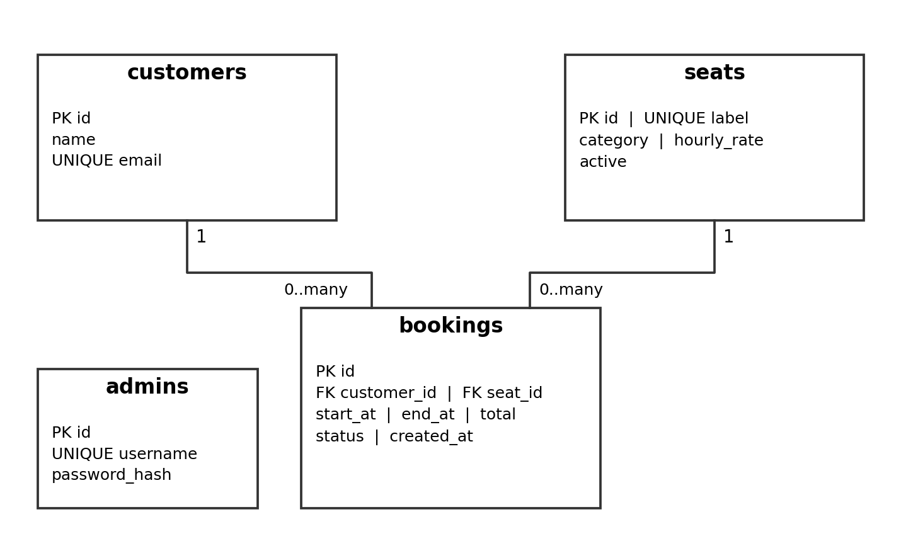

# Task 3 Database and SQL Documentation

## 7.0 Database Design and Implementation

The current schema is defined in compiled/database/proposed_schema.sql. It uses four InnoDB tables and utf8mb4 encoding. Customers, seats and bookings form the related reservation model; admins stores administrator credentials separately. The existing filename is retained. The descriptions in this section document the supplied source; final database acceptance depends on the member’s recorded checks.

## 7.1 Entity relationship design

Figure 3. Logical relationship diagram of the checked-in schema. Each booking has exactly one customer and one seat; customers and seats may each have zero or many bookings. The admins table has no booking foreign key in the current design.

## 7.2 Keys relationships and booking intervals

Primary keys identify each row. Required foreign keys in bookings reference customers.id and seats.id, preventing bookings that refer to nonexistent records. No cascade rule is declared; referenced parent rows are not automatically deleted. Unique customer emails support reuse of an existing customer record, while unique seat labels prevent duplicate station names. The booking handler retains the existing customer name when an email is reused.

The start_at and end_at DATETIME columns store the reserved interval. PHP enforces future hourly starts, a one-to-four-hour duration, a 90-day horizon and closing by 22:00. The SQL schema itself does not declare CHECK constraints for these rules or positive prices. The composite index seat_time(seat_id,status,start_at,end_at) supports lookup by station, confirmation status and interval. PHP locks the selected seat and checks overlap inside a transaction; concurrency testing remains unperformed.

## 7.3 Data dictionary

All columns below are NOT NULL. Every id is an auto-incrementing INT primary key. A dash means no explicit default is declared; it does not mean NULL is allowed. Definitions are transcribed from the supplied schema.

## Customers

| Column | SQL type | Constraint or default | Purpose |
| --- | --- | --- | --- |
| id | INT | PK; AUTO_INCREMENT | Customer identifier |
| name | VARCHAR(100) | — | Stored customer name |
| email | VARCHAR(190) | UNIQUE | Customer lookup and reuse |

## Seats

| Column | SQL type | Constraint or default | Purpose |
| --- | --- | --- | --- |
| id | INT | PK; AUTO_INCREMENT | Seat identifier |
| label | VARCHAR(50) | UNIQUE | Public station label |
| category | ENUM('Standard','Premium') | — | Station category |
| hourly_rate | DECIMAL(7,2) | — | Price per hour in BND |
| active | TINYINT(1) | DEFAULT 1 | Included in active listings when 1 |

## Bookings

| Column | SQL type | Constraint or default | Purpose |
| --- | --- | --- | --- |
| id | INT | PK; AUTO_INCREMENT | Booking reference number |
| customer_id | INT | FK → customers.id | Customer for reservation |
| seat_id | INT | FK → seats.id | Reserved station |
| start_at | DATETIME | — | Session start |
| end_at | DATETIME | — | Session end |
| total | DECIMAL(9,2) | — | Stored value calculated at booking |
| status | ENUM('confirmed','cancelled') | DEFAULT 'confirmed' | Reservation status |
| created_at | TIMESTAMP | DEFAULT CURRENT_TIMESTAMP | Record creation time |

## Administrators

| Column | SQL type | Constraint or default | Purpose |
| --- | --- | --- | --- |
| id | INT | PK; AUTO_INCREMENT | Administrator identifier |
| username | VARCHAR(100) | UNIQUE | Login name |
| password_hash | VARCHAR(255) | — | Password hash; no plaintext password |

## 7.4 Initial data and installation

The seed inserts PC-01 and PC-02 as Standard seats at BND 3/hour, and PC-03 and PC-04 as Premium seats at BND 5/hour. Customer and booking records arise through application use. No administrator is seeded; the existing CLI create_admin.php script creates one using password_hash. INSERT IGNORE and CREATE TABLE IF NOT EXISTS do not make this script a migration tool or reset an existing installation.

For a clean installation, start Apache/MySQL in an isolated XAMPP setup, import the schema, configure the ignored local connection file and create an administrator if needed. Confirm the four tables and four initial seats, then test the application. The earlier successful import and seat retrieval were observed; a fresh installation of the final assembled package remains to be confirmed.

## 8.0 Reports and SQL Queries

The compiled database/report_queries.sql file contains four reports. The dashboard currently renders the daily report only; the other queries are available for manual SQL analysis. Summary totals count confirmed bookings and reserved session value, not payment received. The aliases total_revenue in two queries are historical names for booking value, because the application has no payment records.

## 8.1 Daily confirmed bookings

DATE(start_at) groups reservations by session date. COUNT(*) counts confirmed booking rows; SUM(total) sums stored booking values. Cancelled rows are excluded, and dates are returned newest first.

USE levelup_db;
SELECT DATE(start_at) AS booking_date, COUNT(*) AS sessions, SUM(total) AS booked_value
FROM bookings WHERE status='confirmed' GROUP BY DATE(start_at) ORDER BY booking_date DESC;

## 8.2 Overall confirmed bookings

This aggregate counts all confirmed reservations and sums their stored values. With no matching rows COUNT returns zero and SUM returns NULL; the SQL does not apply COALESCE.

-- Report 1: Overall confirmed bookings and revenue
SELECT
    COUNT(*) AS total_bookings,
    SUM(total) AS total_revenue
FROM bookings
WHERE status = 'confirmed';

## 8.3 Confirmed bookings by seat category

An inner join matches bookings to seats through seat_id. Confirmed reservations are grouped by seat category. Categories without confirmed reservations are absent because the query starts from bookings and uses an inner join.

-- Report 2: Bookings and revenue by seat category
SELECT
    s.category AS seat_category,
    COUNT(b.id) AS total_bookings,
    SUM(b.total) AS total_revenue
FROM bookings b
JOIN seats s ON b.seat_id = s.id
WHERE b.status = 'confirmed'
GROUP BY s.category;

## 8.4 Detailed customer booking report

Inner joins resolve customer names and station labels. TIMESTAMPDIFF(HOUR,start_at,end_at) reports whole-hour duration, consistent with the application’s hourly sessions. There is no status filter: cancelled reservations remain visible until deleted. Rows are ordered by booking ID.

-- Report 3: Detailed customer booking report
SELECT
    b.id AS booking_id,
    c.name AS customer_name,
    s.label AS gaming_pc,
    b.start_at,
    b.end_at,
    TIMESTAMPDIFF(HOUR, b.start_at, b.end_at) AS duration_hours,
    b.total AS total_price,
    b.status
FROM bookings b
JOIN customers c ON b.customer_id = c.id
JOIN seats s ON b.seat_id = s.id
ORDER BY b.id;

## 8.5 Recorded results and outstanding SQL verification

Earlier observed dashboard results showed two confirmed sessions valued at BND 6 and BND 3, producing two sessions/BND 9. Cancelling LU-2 reduced the summary to one session/BND 6; deleting the cancelled row did not change that total. Later Task 2 evidence shows LU-3 at BND 9 on 23 October, its cancellation excluding that date, and deletion leaving LU-1 at BND 6. Appendices E–F show the later dashboard results.

Execution and results for the overall, category and detailed SQL reports have not been supplied. Their descriptions above are based on source inspection, not fabricated query outputs. A useful isolated test is a two-hour Standard booking at BND 3/hour and a one-hour Premium booking at BND 5/hour: if these are the only confirmed records, expected totals are two sessions/BND 11, split as Standard BND 6 and Premium BND 5. These expected values are a verification example, not a reported pass.

## Latest testing update

The project owner reports that the tests work. No additional test screenshots, logs or individual result tables were supplied with this update. This statement is user-reported, not an independently observed acceptance result. Existing Task 1/2 screenshots remain the evidence for their recorded cases. No detailed new SQL outputs were supplied.
